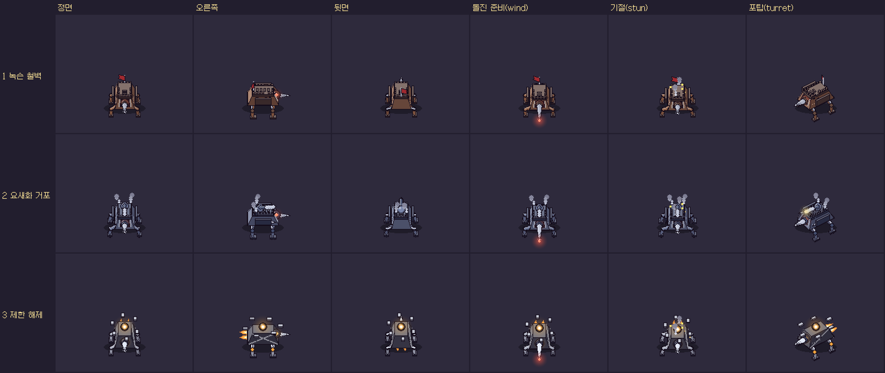
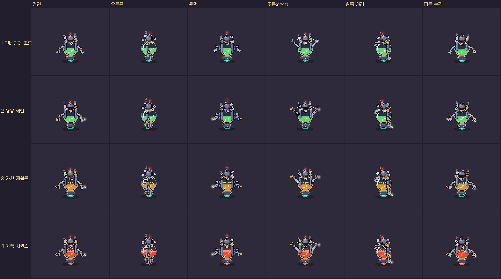
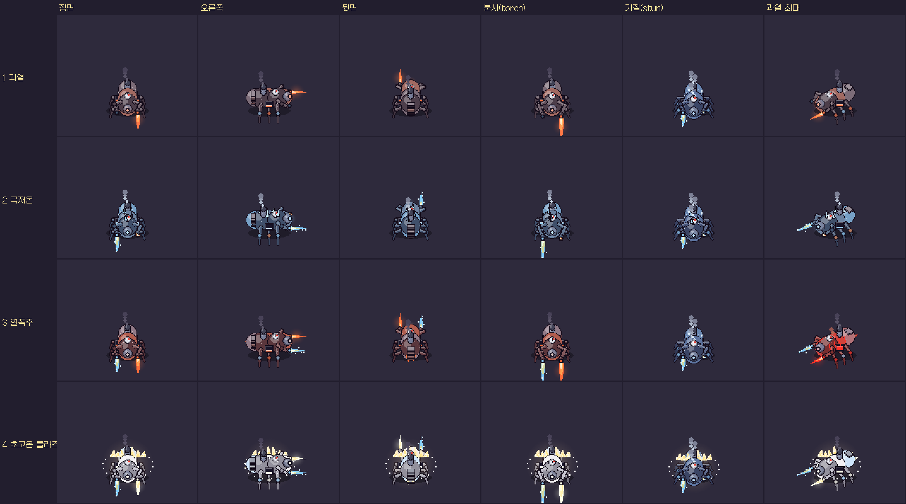
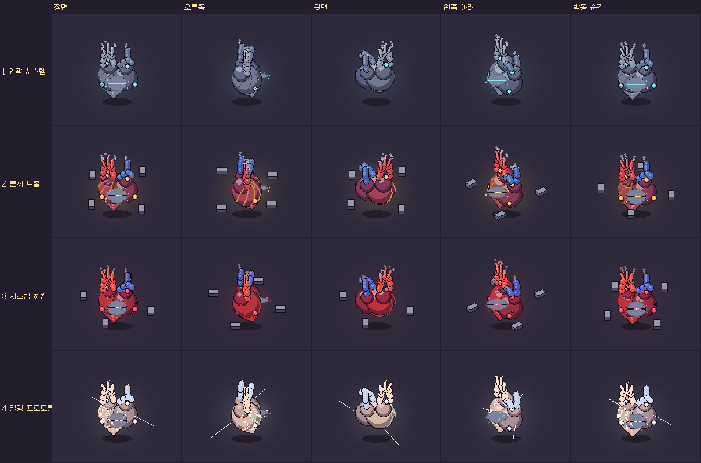
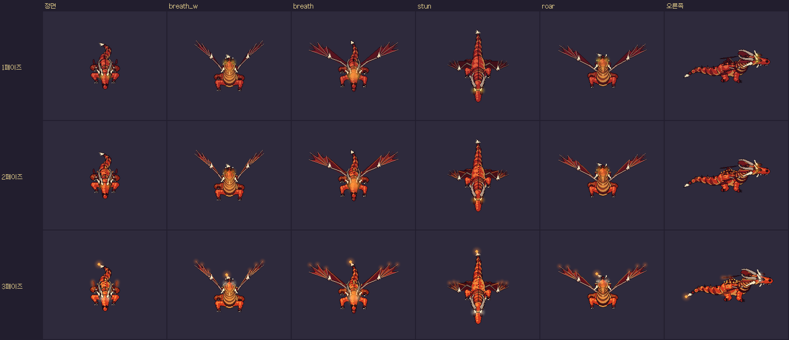
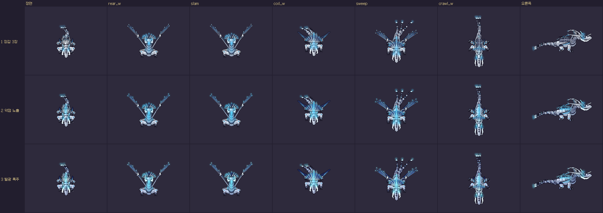

# 보스 모델링 방법

이 게임의 보스는 **그림 파일이 하나도 없습니다.** 모든 보스를 매 프레임 코드로 그립니다.
3D 좌표로 몸을 조립하고, 위에서 42° 내려다보는 쿼터뷰로 투영한 뒤, **최종 크기(1:1 도트)에서 바로** 그립니다.
그래서 어느 방향으로 몸을 돌려도 8방향 스프라이트처럼 끊기지 않고, 확대·축소로 흐려지지도 않습니다.

방식은 두 갈래입니다.

| 방식 | 쓰는 보스 | 핵심 파일 |
| --- | --- | --- |
| **부품 조립형 3D** (상자·절두체·캡슐·구를 쌓는다) | 수문장 벌크스틸 · 공장장 알케미스트 · 수석 정비관 오버히트 · 빅 브라더 Ω | `v9_ba_r3.py` (엔진), `v9_ba_kit.py` (도트 도구), `v9_ba_bulk/alch/heat/core.py` (보스) |
| **뼈대 리그 + 포즈 수치** (척추 체인·IK 다리·관절 날개) | 화룡 이그니스 · 필드 보스 탈라소르 | `v9_dragon_rig.py` / `v9_kaiju_rig.py` (리그), `v9_dragon_fx.py` / `v9_kaiju_fx.py` (포즈·연출) |

모든 보스를 한눈에 보려면:

```
python tools/boss_sheet.py
```

`docs/boss_sheets/` 에 보스마다 **페이즈(행) × 방향·동작(열)** 시트가 만들어집니다. 모델을 고친 뒤에는 꼭 이 시트로 모든 페이즈와 방향을 확인하세요.



---

## 1. 공통 바탕: 좌표계와 투영

### 모델 좌표
- `x` = 앞(보스가 바라보는 쪽), `y` = 오른쪽, `z` = 위
- 모델 1단위 = 화면 1픽셀 (빅 브라더만 `k=1.7` 배율)
- 원점 = 보스 발밑 중심

### 화면으로 옮기기 (`v9_ba_r3.Scene.pj`)
1. **방향 회전**: 보스가 보는 각도 `heading`(0 = 화면 오른쪽, 90° = 화면 아래)만큼 z축으로 돌린다
   `wx = x·cos h − y·sin h`, `wy = x·sin h + y·cos h`
2. **쿼터뷰 투영** (위에서 42° 내려다봄, `SE = sin 42°`, `CE = cos 42°`)
   `화면 x = 기준점x + wx`
   `화면 y = 기준점y + wy·SE − z·CE`
   `깊이 = wy·CE + z·SE` (값이 클수록 카메라에 가깝다)

### 그리는 순서: 화가 알고리즘
부품을 바로 그리지 않고 `(깊이, 종류, 데이터)` 목록에 쌓았다가, `flush()` 에서 **깊이가 작은(먼) 것부터** 그립니다.
그래서 몸을 돌리면 다리·팔·꼬리가 자연스럽게 몸 앞뒤로 들어갑니다.
부품마다 `bias` 를 더해 순서를 미세하게 조정합니다(예: 다리는 `bias=-2` 로 항상 몸통보다 조금 뒤).

### 명암: 빛은 항상 왼쪽 위
면마다 법선을 구해 고정된 빛 방향 `LIGHT = (−0.42, −0.55, 0.72)` 과 내적한 값으로
`어두운색 ↔ 밝은색` 사이를 섞습니다(`Scene.face`). 빛이 월드 기준이라 **몸을 돌려도 빛은 같은 쪽에서** 옵니다.
보는 쪽을 등진 면(`법선 · VIEW ≤ −0.02`)은 그리지 않습니다(뒷면 제거).

### 도화지(canvas)
- 부품 조립형: 220×190 투명 도화지, 기준점 (110, 150) = 발밑
- 화룡: 440×380 (날개를 펼치면 크다). 탈라소르도 같은 방식의 큰 도화지(`v9_kaiju_rig.CW × CH`)
- 보스마다 도화지를 하나씩 재사용합니다(`canvas(key)` 가 지우고 돌려준다). 피격 점멸은 도화지 전체에 흰색을 더하는 `K.flash` 한 번이라 그리기 코드는 점멸을 신경 쓰지 않습니다.

---

## 2. 부품 조립형 3D (`v9_ba_r3.py`)

### 부품(프리미티브)
| 함수 | 모양 | 쓰임 예 |
| --- | --- | --- |
| `box(x0,x1,y0,y1,z0,z1,색)` | 직육면체 (윗면 + 4옆면, 면마다 명암) | 발, 성가퀴, 장갑판 |
| `frustum(bx,by,tx,ty,z0,z1,색)` | 아래가 넓고 위가 좁은 사각뿔대 | 벌크스틸 몸통(성벽) |
| `ball(p, r, 색)` | 구 (외곽선 + 3톤 하이라이트) | 관절, 머리, 심장의 심실 |
| `caps(a, b, w1, w2, 색)` | 굵기가 변하는 캡슐(막대) | 다리 뼈, 팔, 굴뚝, 혈관 |
| `face(점들, 색, 중심)` | 3D 다각형 한 면 (자동 명암·뒷면 제거) | 성문 아치, 녹 얼룩 |
| `poly(점들, 색)` | 명암 없는 다각형 | 깃발, 드릴 끝, 말뚝 |
| `line(a, b, 색, 굵기)` | 3D 선 | 이음매, 리벳, 보강재 |
| `fn(p, f)` | 그 위치·깊이에 임의 그리기 함수 | 눈, 불꽃, 증기, 빛무리 |

`fn` 이 중요합니다. 3D로 만들기 어려운 것(빛나는 눈, 증기, 불꽃)은 **위치와 깊이만 3D로 정하고** 그림은 2D 도트 함수(`v9_ba_kit`)로 그립니다.

### 도트 도구 (`v9_ba_kit.py`)
`glow`(부드러운 빛), `puff`(피어오르는 증기), `flame`, `jet`(분사), `sparks`, `gear`(톱니), `shadow_at`(바닥 그림자),
`mix / lit / drk`(색 섞기·밝게·어둡게), `put`(도화지를 화면에 얹기: 기준점·배율·투명도·색 입히기).

### 뼈대 대신 IK
부품 조립형 보스에는 뼈대 계층이 없습니다. 몸통은 고정된 부품이고, **다리만 2관절 IK** 로 계산합니다.

`leg_ik(엉덩이, 발, 허벅지 길이, 정강이 길이, 무릎 방향)` → 무릎 위치
1. 엉덩이–발 거리 `L` 이 두 뼈 길이 합보다 길면 발을 끌어당긴다
2. 코사인 법칙으로 엉덩이에서 무릎까지의 투영 거리 `a = (l1² − l2² + L²) / 2L`, 높이 `h = √(l1² − a²)`
3. `무릎 방향` 벡터에서 엉덩이–발 방향 성분을 빼서 무릎이 꺾이는 쪽을 정한다

### 걷기 (보행 주기)
- `R3.anim(e)` 가 보스 위치 변화로 **실제 이동 속도**와 진행 방향을 잽니다
- 걸음 위상 `g += 0.6 × 앞방향 속도 × dt / 12` → **실제로 움직인 만큼만** 발이 움직여 미끄러지지 않습니다
- 다리마다 위상차(`PHASE_OFF`)를 줍니다: 벌크스틸 = 대각선 걸음(0, .5, .5, 0), 오버히트 = 삼각 보행(앞·뒤 같은 쪽 + 가운데 반대쪽)
- 한 주기의 65%는 발이 땅을 밀고(뒤로), 35%는 들어 올려 앞으로(사인 곡선으로 들림)
- 몸통은 걸음에 맞춰 위아래로 살짝 출렁입니다(`bob`)

### 몸 돌리기
`turn_toward(st, 목표각, dt, 속도)` 가 지수적으로 목표 방향(보통 플레이어 쪽)을 따라갑니다.
돌진(dash) 중에는 빠르게(8), 평소에는 천천히(5) 돌아 무게감을 냅니다.

### 애니메이션 = 시간 + 상태
키프레임은 없습니다. 매 프레임 다음 값으로 모양을 계산합니다.
- `e["an"]` : 보스 시간(초). 박동·흔들림·회전은 전부 `sin(an × 속도)` 로
- `e["st"]` : AI 가 정한 현재 동작. 예: `wind`(공격 준비), `dash`, `stun`, `turret`, `cast`, `torch`, `leap`
- `e["phase"]` : 페이즈(1~4). 팔레트·부품 추가/제거를 바꾼다
- `e["fl"]` : 피격 점멸 시간

예) 벌크스틸 `wind`: 웅크리고(`crouch=4`) 드릴이 16만큼 길게 뻗으며 끝이 붉게 빛나고, 경고 사각형이 깜빡인다.

### 보스별 부품 구성

**수문장 벌크스틸** (`v9_ba_bulk.py`) — 네 발 이동식 성문 요새
| 부위 | 부품 |
| --- | --- |
| 몸통 | `frustum` 성벽(아래 25×16 → 위 17×10.5) + 위·아래 띠 + 윗면 성가퀴 `box` 들 |
| 다리 4 | IK 캡슐 2개 + 유압 피스톤 캡슐 + 무릎 `ball` + 발 `box` |
| 앞면 | 성문 아치 `face`, 외눈 `fn`(시선이 플레이어를 따라감), 1페이즈 쇠창살 `line` |
| 무기 | 진행 방향 드릴: 캡슐 + 회전 나선 `line` + 끝 `poly` |
| 페이즈 | 1 녹슨 갈색·깃발 / 2 푸른 강철·등 포탑(조준 각도로 회전)·배기 증기·말뚝 발 / 3 장갑 분리(6장이 궤도를 돈다)·코어 노출·X 보강재·후방 분사 |

**공장장 알케미스트** (`v9_ba_alch.py`) — 떠 있는 반응로 플라스크
| 부위 | 부품 |
| --- | --- |
| 몸통 | 유리 플라스크 `fn`(액체 높이·출렁임 2D 도트) + 원형 받침 + 하부 분사 |
| 머리 | 황동 목 캡슐 + 구 머리 + 눈 가리개 `box` + 깜빡이는 안테나 |
| 팔 | 어깨–팔꿈치–손 캡슐, 끝에 도구(플라스크·집게·용접기·렌치) |
| 기타 | 어깨 굴뚝 2개 + 증기, 머리 주위를 도는 톱니 6개 |
| 페이즈 | 액체 초록 → 주황 → 붉은 용융 / 팔 2개 → 2페이즈부터 4개 / 4페이즈 끓어 넘침 |

**수석 정비관 오버히트** (`v9_ba_heat.py`) — 열·냉기 이중 구동 6족 보일러 거미
| 부위 | 부품 |
| --- | --- |
| 몸통 | 가로 보일러 탱크(앞 절반 열, 뒤 절반 냉기), 점검창 온도계 |
| 다리 6 | IK, 삼각 보행 |
| 팔 2 | 오른쪽 냉동 노즐 / 왼쪽 불 토치 (`torch` 때 앞으로 뻗어 분사) |
| 상태 | `heat`(0~100) 가 오를수록 진동·균열, `stun` 은 푸른 냉각 상태로 주저앉음, `lift` 로 도약 높이 |
| 페이즈 | 1 붉음 / 2 극저온(성에) / 3 열폭주 / 4 백열 플라즈마 오라 |

**빅 브라더 Ω** (`v9_ba_core.py`) — 감시하는 기계 심장
| 부위 | 부품 |
| --- | --- |
| 심장 | 좌·우심실, 두 심방, 심첨을 겹친 `ball` (배율 1.7) |
| 혈관 | 대동맥궁·폐동맥·정맥을 점 목록으로 이은 캡슐 튜브(`_tube`) |
| 눈 | 앞면 거대한 눈 `fn` — 몸이 화면을 향할수록 크게 보인다 |
| 표면 | 구 표면 위 곡선(`_surface_curve`): 이음매, 맥동하는 관상동맥, 4페이즈 균열 |
| 박동 | `beat(t, rate)` 쿵-쿵 두 박. 부피가 9% 부풀고 빛이 세진다. 페이즈마다 빨라짐(1.0 → 3.2) |
| 페이즈 | 1 차가운 강철 + 서브 코어 케이블 / 2 붉은 살·파편 궤도 / 3 곁눈·글리치 / 4 뼈색·균열 빛·전기 호 |

---

## 3. 뼈대 리그 + 포즈 수치 (화룡 · 탈라소르)

큰 생물형 보스는 **관절 위치를 수치로 정하는 리그**를 씁니다. 리그 파일은 게임 코드에 의존하지 않고 pygame 과 math 만 씁니다.

### 뼈대 구성 (`v9_dragon_rig.draw`)
| 부위 | 구조 |
| --- | --- |
| 몸통 | 척추를 따라 놓인 구 4개(가슴이 `chest` 만큼 부푼다) + 등 가시 8개 |
| 다리 4 | 엉덩이–무릎–발 **2관절 IK** (허벅지 15, 정강이 14), 발톱 3개. 대각선 보행 위상(0, .25, .5, .75) |
| 꼬리 | 12마디 체인. 마디마다 사인파로 흔들리고(`tamp`, `tfreq`), 몸이 돌면 반대로 휘고(`turn`), 끝은 날(블레이드) |
| 목·머리 | 목 마디 체인 + 머리(배율 `HS=1.4`), 입 벌림 `mouth`, 머리 높이·앞뒤 `hx/hz`, 머리 숙임 `hp`, 고개 돌림 `hyaw` |
| 날개 2 | 어깨 → 팔꿈치 → 손목 → 손가락 4개, 손가락 사이 막. 접힘 `wfold`(1이면 몸에 붙인 덩어리), 날갯짓 `wamp/wfreq`, 기본 각 `wb0`, 뒤로 젖힘 `wsw` |

몸 전체에는 **피치·롤**(`pitch`, `roll`)과 **고도**(`alt`)가 적용됩니다. 고도가 오르면 그림자가 몸에서 떨어지고 꼬리가 덜 처집니다.

### 포즈 = 숫자 26개
포즈는 키프레임이 아니라 `DEF` 의 수치 묶음입니다 (`alt, bz, pitch, roll, hx, hz, hp, hyaw, mouth, nk, wfold, wamp, wfreq, wb0, wsw, tamp, tlift, tcurl, tfreq, tuck, brace, fz, fxo, scr, glow, chest`).
예) `fz` = 앞발 들기, `scr` = 땅 긁기 떨림, `tuck` = 날 때 다리 접기, `brace` = 다리를 벌려 버티기.

### 포즈 섞기 (`update`)
매 프레임 현재 포즈를 목표 포즈 쪽으로 **지수적으로** 다가가게 합니다.

```
현재값 += (목표값 − 현재값) × (1 − e^(−dt × 속도))
```

키마다 섞는 속도가 다릅니다(`RATE`: 고도 3.2, 날개 접기 8, 고개 10 …). 빠른 동작(`FAST`: 돌진·내려찍기 등)은 전체 속도를 14로 올립니다.
그래서 포즈 사이 전환이 자동으로 부드럽고, 동작을 끊어도 튀지 않습니다.

### 동작 표 (`v9_dragon_fx.BASE`)
상태 이름마다 목표 포즈가 있습니다. 화룡 24개, 탈라소르 30개.
예) `breath_w`(숨 들이쉬기) = 상체를 세우고(`pitch .32`, `hz 44`), 앞발을 들고(`fz 12`), 가슴이 빛나고(`glow 1`, `chest .12`), 날개를 반쯤 편다.

### 신호(cue)로 순간 동작 얹기 (`build_pose`)
패턴 코드가 공격 순간에 `cue(g, e, "slam")` 처럼 신호를 보내면, 기본 포즈 위에 **짧은 펄스**를 더합니다.

```
pulse(경과, 상승, 감쇠) : 상승 시간 동안 0→1, 그 뒤 지수적으로 사그라듦
slam: 앞발 높이 × (1−d), 머리 −22×d, 피치 −0.55×d ...
```

맞았을 때 움찔(`fl`), 페이즈가 오를수록 기본 발광(`glow`)도 여기서 더합니다.

### 몸 방향 규칙
- `AIM` 패턴(조준 공격): 빠르게 돌아 정확히 플레이어 쪽을 본 채 공격
- `LOCK` 패턴(광역): 시작할 때 방향을 고정 (플레이어를 따라 돌지 않는다)
- 그 외: 머리가 먼저 돌고 몸통·꼬리가 늦게 따라온다 (`hyaw` 가 빠르고 heading 이 느림)

### 연출 모듈 (`*_fx.py`)
리그 바깥의 것들: 입자(불씨·먼지·얼음), 충격파 고리, 잔상, 페이즈 전환 폭발, 처치 연출, 탑다운 브레스(v9_pfx 연동).
화룡은 패턴 함수들을 감싸(`v9_dragon_fx.WRAP`) 시작·타격 순간에 `cue` 를 보내기만 합니다. **전투 판정은 건드리지 않습니다.**

### 탈라소르의 차이 (`v9_kaiju_rig.py`)
화룡과 같은 리그 방식에 다음이 추가됩니다.
- 넓은 머리 + 아래턱에서 솟은 엄니 2개, 부채처럼 펴지는 가시 왕관(`crown` 수치, 섞는 속도 6)
- 꼬리 **세 갈래** (`tsplit` = 세 갈래가 벌어지는 정도), 배를 땅에 붙이고 기는 자세 `low`
- 등 장갑판 3장(`draw(..., armor=남은 수)`: 깨지면 푸른 균열의 약점이 드러남)
- 눈·무늬·가시 끝이 전기 같은 푸른빛으로 맥동
- 페이즈 팔레트(`v9_kaiju_fx.PALS`) 세 개가 거의 같은 색이라 페이즈 구분이 약하다 (개선 거리 참고)

---

## 4. 게임에 얹기

| 보스 | 연결 | 그리는 곳 |
| --- | --- | --- |
| 중간보스 3기 · 빅 브라더 | `v9_boss_art.apply(v9_roster)` 가 `draw_mid` / `draw_final` 을 교체 | `K.put(화면, 도화지, x, y, anchor=(110,150), scale)` |
| 화룡 | `v9_dragon_fx.install` 이 화룡 그리기와 패턴을 감쌈 | `draw_core` → 리그 도화지를 기준점(발밑)에 맞춰 얹음 |
| 탈라소르 | `v9_kaiju_fx.install` | 같은 방식 |

추가 연출:
- **잔상**: 돌진 중(`e["_dash"]`)에는 도화지를 복사해 보스 색을 입혀 0.26초 동안 남긴다
- **등장 연출**: `g["intro"]` 동안 빛무리가 커진다
- **이펙트 시트**: `v9_pfx.py` 가 `fx_sheets/*.png` (pixelfx 로 만든 바닥 이펙트)를 패턴 순간에 얹는다

---

## 5. 새 보스를 만들거나 고칠 때

1. **형태 잡기** — 부품 조립형이면 `v9_ba_bulk.py` 를 복사해 시작합니다. `Scene` 에 몸통(frustum/ball) → 다리(IK) → 얼굴(fn) → 무기 순서로 쌓고 `flush()`.
2. **실루엣 먼저** — 작은 화면에서 보스는 50~150픽셀입니다. 세부보다 **정면·옆·뒤 실루엣이 서로 다른지**를 먼저 봅니다.
3. **페이즈마다 실루엣을 바꾸기** — 색만 바꾸면 작은 화면에서 구분이 안 됩니다. 부품을 더하거나 떼거나(포탑, 팔 수, 장갑 분리) 크기를 바꿉니다.
4. **동작은 상태 + 시간으로** — AI 가 `e["st"]` 를 바꾸면 그리기 코드가 그 상태의 모양을 계산합니다. 준비 동작(`*_w`)을 반드시 만들어 공격을 예고합니다.
5. **리그형은 포즈 표에 한 줄** — `BASE["새동작"] = P_(...)` 를 넣고, 순간 동작은 `build_pose` 에서 `cue` 펄스로 얹습니다.
6. **확인** — `python tools/boss_sheet.py` 로 모든 페이즈·방향을 보고, `python test_smoke.py` 로 전투가 깨지지 않았는지 봅니다.

### 알려진 개선 거리 (모델 시트 기준)
- 중간보스가 화룡·탈라소르에 비해 작다 (50~60px vs 150px 이상) → `v9_boss_art.SC_` 배율로 키울 수 있다
- 화룡·탈라소르는 페이즈별 외형 차이가 작다 (특히 탈라소르 장갑판이 대기 자세에서 잘 안 보인다)
- 알케미스트 옆모습에서 팔이 플라스크 앞을 가로지른다 (팔 `bias` 조정 필요)
- 알케미스트 2·3페이즈는 액체 색 외에 실루엣 차이가 적다
- 벌크스틸·오버히트·빅 브라더가 정면에서 '둥근 몸통 + 눈 하나'로 비슷하다

---

## 부록: 시트 모음

| 보스 | 시트 |
| --- | --- |
| 수문장 벌크스틸 |  |
| 공장장 알케미스트 |  |
| 수석 정비관 오버히트 |  |
| 빅 브라더 Ω |  |
| 화룡 이그니스 |  |
| 탈라소르 |  |
